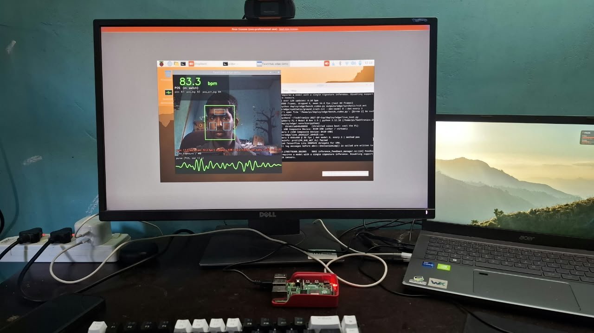
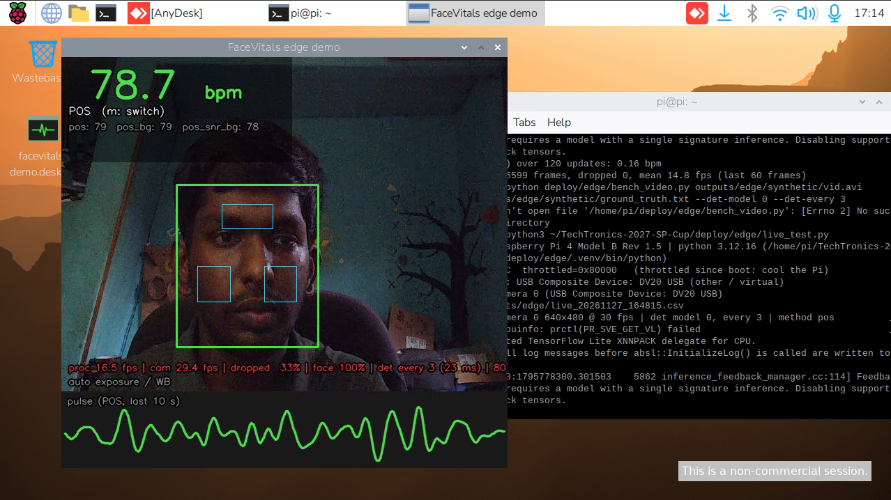
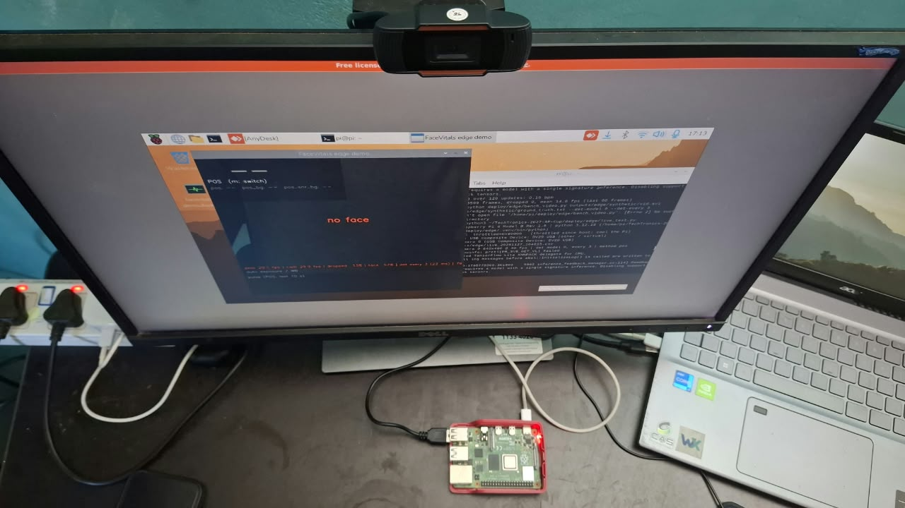

# Edge deployment

Runs the heart-rate pipeline on a small device. The first target is a **Raspberry Pi 4** (64-bit OS).
Testing starts with dataset videos, then moves to a USB webcam.

MATLAB does not run on the Pi, so this is built on the Python port in `src/python/facevitals`
(from PR #2), not on the MATLAB module in `src/face`.

**Status (2026-11-27):** the pipeline installs and runs on the Pi 4 and gives the same HR as the laptop on the
synthetic clip. The live demo (`live_test.py`) runs on the Pi with a USB webcam: face tracked 100 %, an HR every
second, ~18 fps processed, but the live HR is not stable yet and the uncooled Pi throttles. Not yet done: UBFC
on the Pi, a pulse-oximeter reference for the live MAE, cooling.

## Setup (on the Pi)

Use **64-bit** Raspberry Pi OS: `getconf LONG_BIT` must print `64`. (`uname -m` is not enough: the 32-bit
image also boots a 64-bit kernel on a Pi 4 and prints `aarch64`; `setup.sh` checks `LONG_BIT`.) Use a card of
16 GB or more, rated A1 or better: the venv is 1 GB and pip writes many small files.

```bash
git clone https://github.com/ThamilezaiAnanthakumar/TechTronics-2027-SP-Cup.git
cd TechTronics-2027-SP-Cup && git switch edge-deploy
# Trixie only (ships Python 3.13): get Python 3.12 with uv
python3 -m venv ~/.uvtool && ~/.uvtool/bin/pip install uv && ~/.uvtool/bin/uv python install 3.12
export PATH=$HOME/.local/bin:$PATH
bash deploy/edge/setup.sh            # venv in deploy/edge/.venv + import check
```

`mediapipe` is pinned to **0.10.18**. It is the last release that has both the legacy `mp.solutions` API
(used by `facevitals/face.py`) and Linux aarch64 wheels. mediapipe 1.x removed `mp.solutions`, and
0.10.20–0.10.35 have no aarch64 wheels. 0.10.18 needs Python 3.9–3.12. On the Pi, `setup.sh` took 18 min over
Wi-Fi (most of it pip resolving `jax` and downloading), and the import check passes. The harmless message
`Error in cpuinfo: prctl(PR_SVE_GET_VL) failed` is printed on every start: the Cortex-A72 has no SVE.

## Test setup (2026-11-27)

| | |
|---|---|
| Board | Raspberry Pi 4 Model B Rev 1.5, 4 GB, 4× Cortex-A72 @ 1.8 GHz, **no heatsink or fan** |
| OS | Raspberry Pi OS Trixie 64-bit, desktop image 2026-10-06, kernel 6.18.50, X11 session (switched from Wayland for remote desktop) |
| Python stack | Python 3.12.16 (uv), mediapipe 0.10.18, OpenCV 4.11.0 (contrib), NumPy 1.26.4, SciPy 1.17.1 |
| SD card | 64 GB, made 08/2025 (card name `EZSD1`), UHS-I DDR50 |
| Network | Wi-Fi only, 2.4 GHz, signal −67 dBm: 10.9 Mbit/s down / 10.9 up to the internet; laptop → Pi copies ~0.55 MB/s |
| Display | no monitor: 1280×720 headless desktop, used over AnyDesk / SSH (key login) |
| Camera | DV20 USB webcam (Jieli 4c4a:4a55), MJPG 640×480 @ 30, on top of the monitor |
| Reference laptop | x86_64, Python 3.12.3, same requirements |

**SD card.** Measured in the Pi with direct I/O. The first card (an 8 GB card from 2014 with a 32-bit 2023
image) was replaced: too slow, too small (855 MB free after the OS), and the 32-bit OS cannot install mediapipe.

| In the Pi 4 | Old 8 GB card (2014) | Card in use, 64 GB (2025) | A1 minimum |
|---|---|---|---|
| Sequential write | 4.6 MB/s | 26.4 MB/s | 10 MB/s |
| Sequential read | 45 MB/s | 40 MB/s | (Pi 4 slot max ~45) |
| Random 4K read | 1,937 IOPS | 2,331 IOPS | 1,500 |
| Random 4K write | 282 IOPS, stalls up to 750 ms | 779 IOPS, worst 186 ms | 500 |

**Network.** The Pi's Wi-Fi link is weak (−67 dBm, receive rate down to 6.5 Mbit/s, power saving on), so
copying dataset videos is slow. Use Ethernet (the Pi 4 has gigabit; DHCP is set up for `eth0`) for UBFC.

## Initial testing (Phase 1)

All commands from the repo root, with the venv active.

**1. Smoke test, no dataset needed.** A synthetic clip with a known pulse (66 → 84 bpm):
```bash
python deploy/edge/make_test_clip.py
python deploy/edge/bench_video.py outputs/edge/synthetic/vid.avi --gt outputs/edge/synthetic/ground_truth.txt --det-model 0
```
Pass: face found 100 %, MAE under 1 bpm for all three methods. This proves the install, not the accuracy.
On the Pi, `--det-model 0` is required (see "Results").

**2. UBFC on the Pi.** Copy subjects to `data/raw/UBFC/DATASET_2/subjectN/` (`vid.avi` + `ground_truth.txt`), e.g. from the laptop:
```bash
rsync -a data/raw/UBFC/DATASET_2/subject{1,3,4} <user>@<pi>:TechTronics-2027-SP-Cup/data/raw/UBFC/DATASET_2/
```
- Install check, same code as the laptop: `python src/python/run_c2.py --datasets UBFC --subjects subject1 subject3 subject4`.
  The `pos` MAE must match the laptop (1.53 / 3.23 / 2.61 bpm). Note that `run_c2.py` uses the full-range face
  model, which finds no faces on the Pi (see "Results").
- Edge benchmark of one subject: `python deploy/edge/bench_video.py --ubfc 1 --det-model 0`

**3. Timing sweep.** Frame width 640 / 320 × detection every 1 / 2 / 3 / 5 frames. Between runs it waits for
the Pi to cool below 60 °C, for at most 3 min (an uncooled Pi idles at ~62 °C):
```bash
bash deploy/edge/sweep.sh outputs/edge/synthetic/vid.avi --gt outputs/edge/synthetic/ground_truth.txt --det-model 0
python deploy/edge/summary.py        # table of every run, also outputs/edge/summary.csv
```
Pick the cheapest setting that keeps **fps ≥ 30** (or ≥ the webcam's fps) with no MAE loss. That is the setting for Phase 2.

**What `bench_video.py` reports:** fps vs real time, the face-found rate, ms per stage (decode, resize, detect, background, roi_skin), HR cost per window, MAE/RMSE/SUC@5 per method (`pos`, `pos_bg`, `pos_snr_bg`), the CPU temperature, and `get_throttled`. Results go to `outputs/edge/<name>.json`. If the throttle value is not `0x0`, the Pi slowed down during the run, so the timings are not valid.

## Results

### Benchmark: synthetic clip, Pi 4 vs laptop

Synthetic clip (30 s, 640×480, FFV1 lossless, HR 66 → 84 bpm), short-range face model (`--det-model 0`) on both.

| | Laptop | Pi 4 |
|---|---|---|
| Face detection call, short-range model | 5.6–6.8 ms | 12.6–14.2 ms |
| Face detection call, full-range model (`model_selection=1`) | 14.5 ms | 44 ms and **finds no face** |
| Decode of the FFV1 test clip per frame | 6–9 ms | 28–41 ms |
| fps on the clip (all 8 settings) | 53–73 | 20.4–21.1 (decode-bound) |
| Per-frame work without decode, det every 1 → 5 (640 px) | 9.5 → 4.7 ms | 20.6 → 10.2 ms |
| Face found | 100 % | 100 % |
| CPU temperature | 28 °C | 70–72 °C per run; 82 °C and soft-throttled (`0x80000`) after ~25 min of load |

MAE (bpm) for pos / pos_bg / pos_snr_bg, **identical on the Pi and the laptop** (to 0.01 bpm):

| Width | det every 1 | det every 2 | det every 3 | det every 5 |
|---|---|---|---|---|
| 640 | 0.27 / 0.20 / 0.16 | 0.19 / 0.21 / 0.22 | 0.18 / 0.22 / 0.23 | 0.09 / 0.14 / 0.15 |
| 320 | 0.31 / 0.29 / 0.31 | 0.23 / 0.40 / 0.38 | 0.22 / 0.29 / 0.30 | 0.16 / 0.34 / 0.34 |

SUC@5 is 100 % in every run. The clip is a still photo with a synthetic pulse, so these numbers check the
install and the timing, not real-world accuracy.

- **Use the short-range face model on the Pi** (`--det-model 0`; `run_edge.py` and `live_test.py` pick it
  automatically on aarch64). With mediapipe 0.10.18 on aarch64 the full-range model returns no detections at
  all, even at confidence 0.1, on frames that are byte-identical to the laptop's. The short-range model gives
  the laptop's detection scores exactly. It covers faces within about 2 m.
- **The Pi is about 2× slower than the laptop on the pipeline itself and gives the same HR numbers.** On the
  clip it is held to ~20 fps by the lossless FFV1 decode, not by the pipeline: without decode it needs
  10–21 ms per frame, inside the 33 ms budget of a 30 fps webcam. Detecting every 3–5 frames costs no accuracy
  on the clip. Suggested webcam setting: 640 px, detection every 3–5 frames.
- **Cooling is needed.** Each 45 s run reaches 70–72 °C; continuous use reached the 80 °C throttle point.

### Live test (`live_test.py`)

Webcam: "DV20" USB webcam (Jieli, 4c4a:4a55), MJPG 640×480 @ 30, auto exposure / white balance, mounted on
top of the monitor, about 0.6 m from the face, indoor light. Pi settings: short-range model, detection every
3 frames, 640 px. No reference device was worn, so the webcam runs have no MAE.





| Run | Source | Duration | fps (camera / processed) | Face found | HR |
|---|---|---|---|---|---|
| Pi 4 | **DV20 webcam** | 31 min, 1,871 updates | 29.8 / ~18 (16–27); ~40 % of frames dropped | 100 % (median), HR in 94 % of updates | median 76 bpm (pos), unstable, see below |
| Pi 4 | synthetic clip, real-time replay | 2.8 min, 120 updates | – / 16.6 (decode-bound) | 100 % | MAE 0.17 bpm; same values as the laptop |
| Laptop | synthetic clip | 40 updates | – / 51–70 | 100 % | MAE 0.16 bpm |
| Laptop | DV20 webcam | 21 s | 14–15 | 0 % | none: image almost black (~10/255) |

What the 31 min Pi webcam run shows:
- **The pipeline runs live on the Pi:** the face is tracked the whole time and an HR comes every second.
  Processing reaches ~18 fps, not 30: on top of the 10–21 ms pipeline the Pi decodes the MJPG frames and
  draws the window, and the once-per-second HR update takes ~135 ms (p95 153 ms), so frames are dropped.
  The frame timestamps keep the HR timing correct, but the signal has fewer samples.
- **The HR is not stable yet.** pos: median 76 bpm, IQR 59–98, range 42–170 bpm; the per-minute medians move
  between 56 and 106 bpm. The three methods agree within 5 bpm in only 33 % of updates (on the clip they agree
  in 100 %). Likely causes, to be checked one at a time: auto exposure / white balance changing the skin
  colour, light from the monitor whose content changes, head movement, ~18 fps with dropped frames, MJPG
  compression of the small colour changes. A pulse oximeter is needed to say which method is closest.
- **The Pi overheats:** 48 → 82 °C during the run, and `get_throttled` reached `0x80008` (soft temperature
  limit active), so the CPU was slowed down. Fit a heatsink or fan before further timing tests.



The DV20 webcam is not reliable: on the laptop its image was almost black (~10/255, in both auto and locked
exposure; 113/255 a few minutes earlier) and it dropped off USB twice with protocol errors
(`uvcvideo … status -71`), coming back under a new `/dev/videoN`. On the Pi it worked for 31 min, but the
photo above shows it dark with "no face" at one point too.

Changes made after the laptop webcam test: auto exposure / white balance are now the default (`--lock` to
lock them); locked controls are restored on exit (V4L2 controls outlive the program); the window warns when
the image is too dark or too bright; a camera that stops delivering frames ends the run with a message;
`live_test.py` prefers a plugged-in USB webcam over built-in and virtual cameras.

## Live demo

```bash
python3 deploy/edge/live_test.py         # one command: USB webcam if connected, else the synthetic clip (looped)
python3 deploy/edge/live_test.py --camera 1                       # a specific camera (/dev/video1)
python3 deploy/edge/live_test.py --clip --headless --seconds 60   # clip, no window, stop after 60 s
python3 deploy/edge/live_test.py --lock  # lock exposure / white balance after 2 s (steady light only)
python deploy/edge/run_edge.py --video outputs/edge/synthetic/vid.avi --gt outputs/edge/synthetic/ground_truth.txt --loop
```

`live_test.py` uses the venv without activating it, opens the window on the Pi's screen when started over SSH
(`DISPLAY=:0`), picks the camera (USB webcam first, then built-in, then virtual such as Iriun; the Pi's own
codec / ISP video devices are skipped), prints the CPU temperature and throttle state, and logs every HR update
to `outputs/edge/live_<time>.csv` (written as it runs). Other options go to `run_edge.py`
(`--det-every`, `--method`, `--fullscreen`, `--exposure`, ...). The desktop shortcut on the Pi runs it.

The window shows the face box (green; yellow while a lost face's box is held) and ROIs, the HR of the chosen
method (`m` switches between `pos`, `pos_bg`, `pos_snr_bg`), the other two methods, the reference HR and
running MAE when `--gt` is given, the pulse waveform of the last 10 s, fps, dropped frames, the CPU
temperature and a warning when the image is too dark or bright. `q` quits, `r` resets the buffer. The HR is
that of the last complete 10 s window, so it lags by about 5 s. Each HR update costs ~85–120 ms on the Pi and
20–50 ms on the laptop (once per second).

## What is reused

| Stage | Code |
|---|---|
| Face box | `facevitals.face.FaceBox` (MediaPipe, largest face; `model=1` full-range by default, `model=0` short-range for the Pi) |
| ROI + skin mask | `face.roi_rects`, `face.skin_mask`, regions and thresholds from `config/face_config.json` |
| HR | `facevitals.rppg`: POS, 0.7–3 Hz band-pass, 10 s windows, periodogram peak (`sanity_hr`); `sanity_hr_bg` / `sanity_hr_snr` for the improved methods |

`face.face_traces` reads a whole video and then computes HR offline. `run_edge.py` runs the same steps frame
by frame on a rolling buffer.

## Plan

### Phase 1: dataset videos on the Pi (tools ready, see "Initial testing")
- [x] Synthetic smoke test passes on the Pi (with `--det-model 0`, see "Results")
- [x] Sweep: ms/frame and fps at 640 / 320 × detection every 1 / 2 / 3 / 5 frames
- [ ] UBFC `run_c2.py` MAE equals the laptop's (install check; needs the short-range model on the Pi)
- [ ] Choose the setting for the webcam; check no throttling (heatsink or fan: the Pi 4 throttles at 80 °C)

### Phase 2: USB webcam (real world)
`run_edge.py`: webcam → face box → ROI RGB means → 20 s buffer → HR of the last 10 s window every 1 s.
(20 s because `rppg` needs ≥ 270 raw samples; at < 27 fps a 10 s buffer would never give an HR.)
- [x] Capture with `cv2.VideoCapture(N, cv2.CAP_V4L2)` at 640×480, MJPG, 30 fps (capture thread, newest frame kept)
- [x] Timestamp each frame at capture (`time.monotonic()` right after `grab()`). Webcam `CAP_PROP_POS_MSEC` is unreliable, and the real fps drifts in low light.
- [x] Live demo with window, CSV log and one-command start (`live_test.py`)
- [x] Live test on the Pi with a USB webcam: 31 min, face 100 %, HR every second, ~18 fps (see "Live test")
- [ ] Stable live HR: the three methods agree within 5 bpm in only 33 % of updates (see "Live test")
- [ ] **Lock exposure, white balance and gain** for measurements (`--lock`; check with `v4l2-ctl -d /dev/videoN --list-ctrls` that the webcam accepts it). Automatic adjustments change the skin colour over time, and POS picks that up as a false pulse. Auto is the default because it is easier for a demo in changing light.
- [ ] Use steady light. Mains-powered lamps flicker at 100 Hz (50 Hz mains in Sri Lanka), so keep the exposure a multiple of 10 ms.
- [ ] Reference HR from a fingertip pulse oximeter, recorded at the same time, for the MAE
- [ ] Measure sustained fps, latency to the first HR, CPU % and memory

### Later
- [ ] Move `face.py` to the MediaPipe Tasks `FaceDetector`, so newer mediapipe and Python 3.13 work (and check whether the full-range model works on aarch64 there)
- [ ] Test at ≤ 10 fps and ≤ 500 kbps (C5)
- [ ] Heatsink or fan, then repeat the sweep for timings without throttling

## Notes

- The Python port has no C3 multi-face tracking (largest face only) and only the absolute occlusion rule. See `src/python/README.md`.
- `pandas` is installed for `run_c2.py` and the dataset loaders; the live path (`run_edge.py`) does not import it.
- `scikit-image` is installed only because `face.py` imports `rgb2lab` (for ITA) at module level. Moving that import inside the ITA functions would drop it.
- `jax` / `jaxlib` (330 MB) come in as mediapipe dependencies but are not loaded by face detection. On a small card, mediapipe can be installed with `--no-deps` plus its other dependencies to save ~380 MB.
